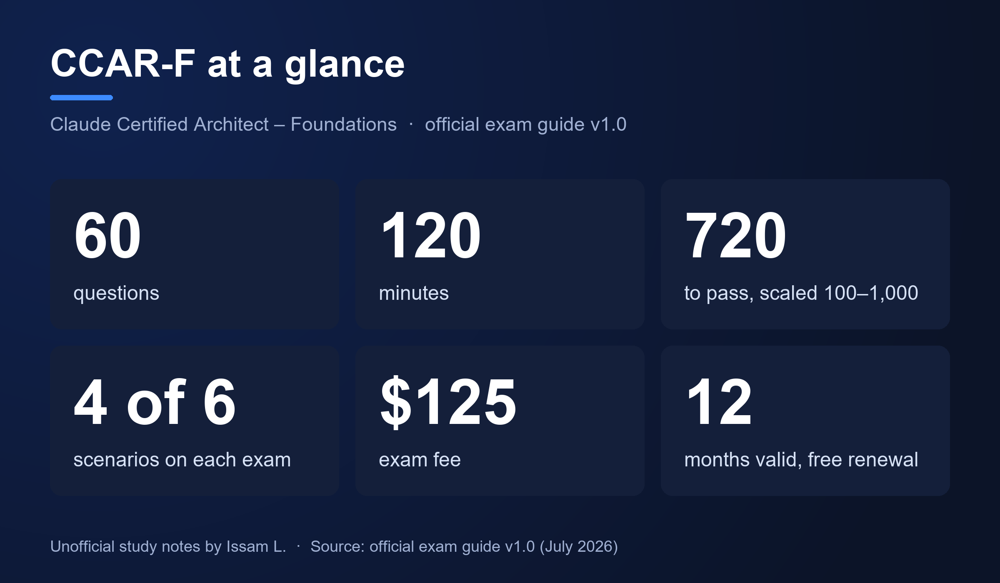
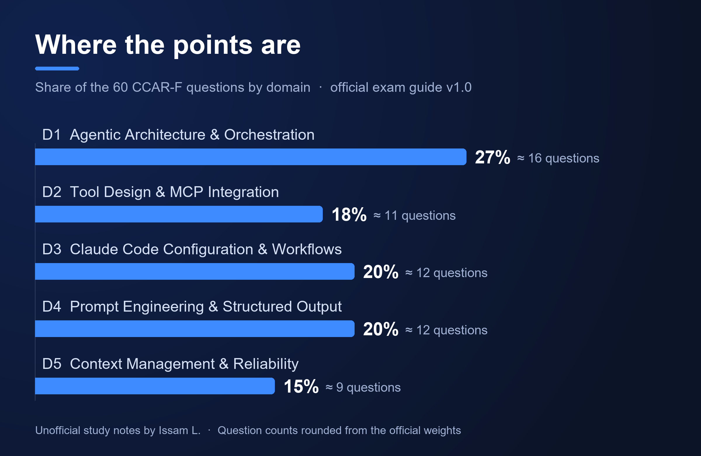
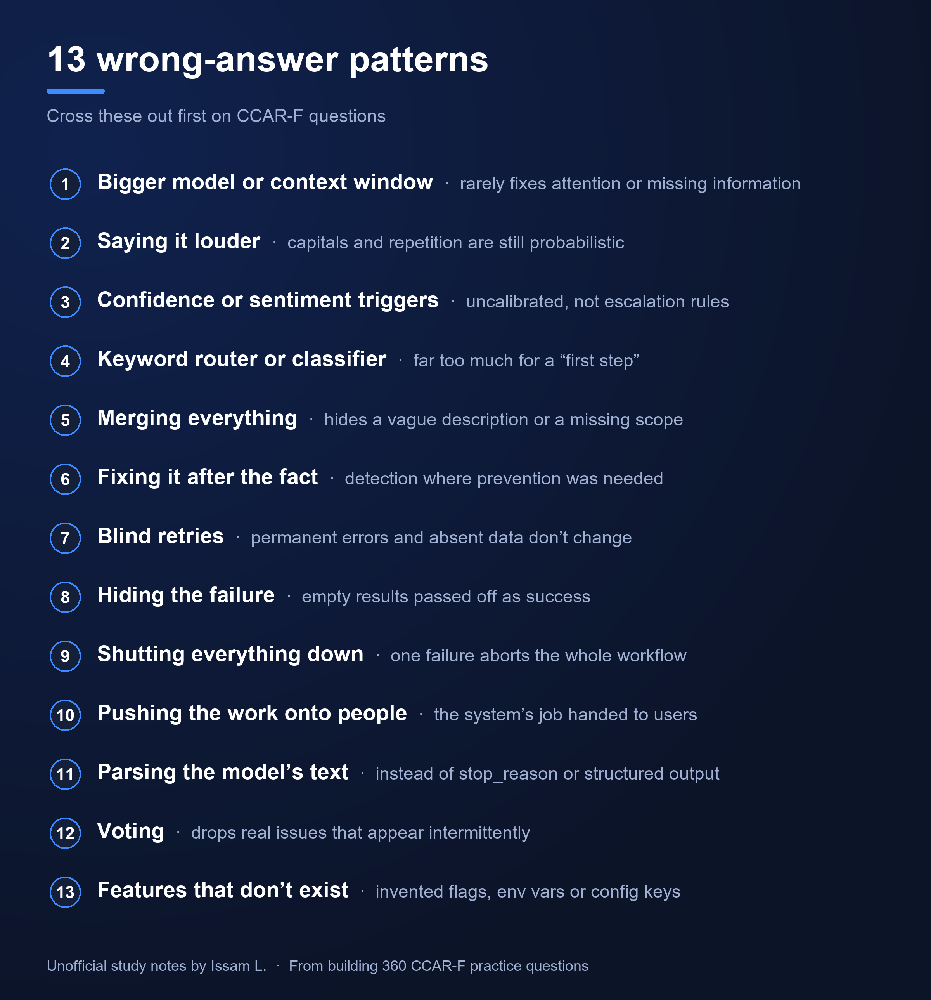

# CCAR-F Study Guide: Claude Certified Architect – Foundations

Free study notes for the **Claude Certified Architect – Foundations** exam (exam code **CCAR-F**, often written CCA-F): the exam format, the five domains, the six scenarios, all 30 task statements, and the 13 wrong-answer patterns that keep coming back.

> Unofficial, independently created study notes. Not affiliated with or endorsed by Anthropic. Exam facts checked against the public exam guide v1.0 (July 2026) and the official certification page in October 2026.

**Free PDF:** the [CCAR-F Pocket Guide](https://issaml.gumroad.com/l/ccar-f-pocket-guide?wanted=true&price=0) (17 pages) adds a 10-question readiness check with explained answers, decision tables, drills and an exam-day plan.

## Contents

- [The exam at a glance](#the-exam-at-a-glance)
- [The five domains](#the-five-domains)
- [The six scenarios](#the-six-scenarios)
- [The 13 wrong-answer patterns](#the-13-wrong-answer-patterns)
- [A five-step method for every question](#a-five-step-method-for-every-question)
- [Sample question](#sample-question)
- [Four-week study plan](#four-week-study-plan)
- [FAQ](#faq)
- [Official resources](#official-resources)
- [More practice](#more-practice)

## The exam at a glance

| Item | Detail |
|---|---|
| Questions | 60, in 120 minutes (about 2 minutes each, with long scenario-based stems) |
| Question types | Multiple choice with one answer, and multiple response. A multiple-response question tells you how many to select ("Select TWO"). |
| Structure | Every question belongs to a scenario. Each exam draws 4 scenarios at random from a bank of 6. |
| Passing score | 720 on a scaled score from 100 to 1,000. Criterion-referenced, no penalty for guessing. |
| Score report | Pass or fail, scaled score, percentage per domain |
| Fee and delivery | $125. Pearson VUE, online or in a test center, in English or Japanese. |
| Validity | 12 months. Renewal is a free, non-proctored assessment. |
| Retakes | After 14 days, then 30, then 90, with at most four attempts in 12 months |

## The five domains

| Domain | Weight | About | What it really tests |
|---|---|---|---|
| D1 Agentic Architecture & Orchestration | 27% | 16 questions | Loop control with `stop_reason`, coordinator and subagent design, passing context explicitly, enforcing rules in code instead of prompts |
| D2 Tool Design & MCP Integration | 18% | 11 questions | Tool descriptions, structured errors, how many tools one agent should get, MCP configuration and resources |
| D3 Claude Code Configuration & Workflows | 20% | 12 questions | The CLAUDE.md hierarchy, `.claude/rules/` with path globs, commands and skills, plan mode, CI runs with `-p` |
| D4 Prompt Engineering & Structured Output | 20% | 12 questions | Explicit criteria, few-shot examples, JSON schemas through tool use, validation and retry, the Message Batches API |
| D5 Context Management & Reliability | 15% | 9 questions | Facts lost in long sessions, escalation triggers, error propagation, human review, provenance |

All 30 task statements, one line each: **[docs/task-statements.md](docs/task-statements.md)**

**Out of scope** according to the guide: fine-tuning, computer use, vision, streaming, rate limits and pricing calculations, model benchmarking and comparisons, embeddings and vector databases, and prompt caching beyond knowing that it exists.

## The six scenarios

| Scenario | What it tends to test |
|---|---|
| Customer Support Resolution Agent | Loop control, refund limits enforced in code, structured tool errors, escalation rules, handoff summaries |
| Code Generation with Claude Code | The CLAUDE.md hierarchy, path-scoped rules, team commands and skills, plan mode |
| Multi-Agent Research System | How the coordinator splits work, parallel subagents, explicit context, keeping sources through synthesis |
| Developer Productivity with Claude | Built-in tools (Grep, Glob, Read, Edit), MCP servers and resources, exploring a large codebase |
| Claude Code for Continuous Integration | Non-interactive runs, JSON output with a schema, review precision, independent reviewers |
| Structured Data Extraction | Tool-use schemas, nullable fields, validation and retry, batch processing, human review |

## The 13 wrong-answer patterns

These came out of building 360 practice questions against the exam guide. Each one is wrong for a reason the exam cares about, and most would be right in some other situation, which is why they're tempting.

| # | Pattern | Why it's usually wrong |
|---|---|---|
| 1 | A bigger model or a bigger context window | Rarely fixes attention, tool selection or missing information |
| 2 | Saying it louder | Capital letters and repeated rules are still probabilistic; a rule that must always hold needs code |
| 3 | Confidence or sentiment as a trigger | Self-rated confidence isn't calibrated, and anger alone isn't a reason to escalate |
| 4 | A keyword router or a classifier | Far too much for a "first step", and it bypasses what the model already understands |
| 5 | Merging everything | Combining tools or agents hides the real issue, often a vague description or a missing scope |
| 6 | Fixing it after the fact | Audits and alerts detect; the scenario usually needs prevention |
| 7 | Blind retries | Permanent errors and information absent from the source don't change on retry |
| 8 | Hiding the failure | An empty result passed off as success misleads the next step |
| 9 | Shutting everything down | One failed step shouldn't abort a whole workflow |
| 10 | Pushing the work onto people | Customers and developers shouldn't do the system's job |
| 11 | Parsing the model's text | Use `stop_reason` or structured output, not words in the reply |
| 12 | Voting across runs | Keeping only what several runs agree on drops real, intermittent issues |
| 13 | Features that don't exist | Made-up flags, environment variables or config keys |

## A five-step method for every question

1. **Name the symptom** in a few words: wrong tool selected, invented data, lost facts, duplicated work, a loop that doesn't stop.
2. **Find the layer that is actually broken:** prompt, tool description, tool interface, schema, loop code, hook, orchestration, configuration location or context management.
3. **Look for words that demand a guarantee** ("must", "never", "always", money, identity, compliance). If you find one, keep only deterministic options.
4. **Cross out the 13 patterns.**
5. **Pick the smallest change that fixes the cause at its own layer.** On multiple-response questions, judge each option on its own.

Read the question sentence before the scenario: "most effective first step", "most likely cause" and "which TWO" each rule out options that would be right for a different question.

## Sample question

An original question in the style of the exam (not a real exam item).

> A platform team uses the Claude Agent SDK to build a deployment agent that can run shell commands. Company policy says the agent must never run "terraform apply" against the production workspace unless the request carries an approved change ticket. In 2% of test runs the agent ignored this rule, even though the system prompt states it. Which TWO changes enforce the policy? (Select TWO.)
>
> **A.** Repeat the rule at the end of the system prompt in capital letters, so it is the last thing Claude reads
>
> **B.** Add a PreToolUse hook that denies the shell call when it targets production without an approved ticket
>
> **C.** Add few-shot examples in which the agent asks for an approved ticket before it applies any change
>
> **D.** Post an alert to the on-call channel whenever a production apply runs without a ticket ID
>
> **E.** Replace the generic shell tool with a deploy tool whose code checks the ticket status before applying

<b>Show the answer and explanation</b>

**B and E.** "Must never" calls for deterministic control.

- **B** is correct: the PreToolUse hook runs before the command executes and can deny it with a reason.
- **E** is correct: a narrow tool that verifies the ticket in code makes the unsafe action unavailable.
- **A** is pattern 2: emphasis is still a prompt, and the 2% failure rate shows prompts can't guarantee the rule.
- **C** makes the behavior more consistent, not guaranteed.
- **D** is pattern 6: the alert fires after production has already changed.

Two correct answers acting at two different layers is a common shape on multiple-response questions.

Ten more questions like this one, with every option explained and a score guide, are in the free [Pocket Guide](https://issaml.gumroad.com/l/ccar-f-pocket-guide?wanted=true&price=0).

## Four-week study plan

| Week | Focus | What to do |
|---|---|---|
| 1 | The source | Read the official exam guide twice, including its sample questions. Take the free Anthropic Academy courses that match the domains: *Building with the Claude API*, *Introduction to Model Context Protocol* and *Claude Code in Action*. |
| 2 | Build small things | An agent loop that stops on `stop_reason`, an MCP tool that returns structured errors, a Claude Code project with a path-scoped rule and a PreToolUse hook. |
| 3 | Timed practice | A full set of 60 questions in 120 minutes, then every explanation, including the questions you got right. Note the patterns that caught you. |
| 4 | Close the gaps | Rework your two weakest domains, one more timed set, then rest. On exam day: about 90 seconds per question on the first pass, flag and move on, keep 15 to 20 minutes to review. |

## FAQ

### How many questions are on the CCAR-F exam?
60 questions in 120 minutes, either multiple choice with one answer or multiple response.

### What is the passing score?
720 on a scaled score from 100 to 1,000. Scoring is criterion-referenced, so your result doesn't depend on other candidates.

### Is CCA-F the same exam as CCAR-F?
Yes. CCAR-F is the official exam code, and many people still write CCA-F.

### Are computer use or prompt caching on the exam?
No. The guide lists computer use as out of scope, and prompt caching beyond knowing that it exists.

### Will the CCAR-F exam change on December 7, 2026?
Anthropic has announced updated content from December 7, 2026 for the Associate, Developer and Architect – Professional exams, with updated guides published on November 17, 2026. Foundations isn't in that list on the official page, but check it before you book.

## Official resources

- [Official CCAR-F certification page](https://anthropic-partners.skilljar.com/claude-certified-architect-foundations-certification): registration, exam guide, eligibility and the free preparation courses
- [Pearson VUE – Anthropic exams](https://www.pearsonvue.com/us/en/anthropic.html): scheduling and test-day requirements

## More practice

- **Free:** [CCAR-F Pocket Guide](https://issaml.gumroad.com/l/ccar-f-pocket-guide?wanted=true&price=0), 17 pages with a 10-question readiness check and explained answers.
- **Paid:** [six timed 60-question practice exams on Udemy](https://www.udemy.com/course/claude-certified-architect-foundations-ccar-f-practice-exams-u/?referralCode=627B3B017730B8FD8CEF), built on the same blueprint, with multiple-response questions and difficulty that rises from exam 1 to exam 6.

Disclosure: I made both.

## About this repository

Written by Issam L. with the help of Claude Code, and checked against the official exam guide v1.0. If you spot an error or something outdated, please [open an issue](../../issues).

## License

Text and images: [CC BY-NC 4.0](https://creativecommons.org/licenses/by-nc/4.0/). You may share and adapt them for non-commercial use with attribution. See [LICENSE](LICENSE).
